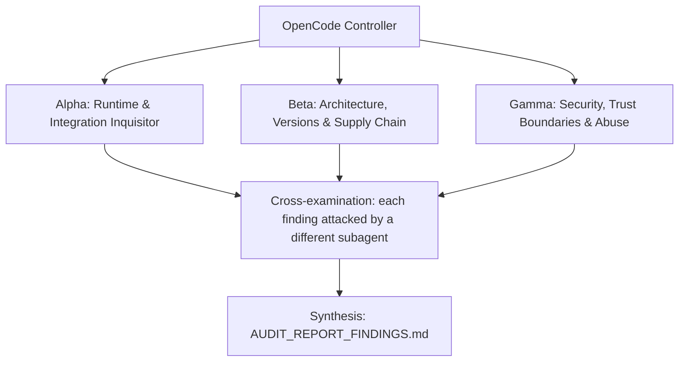

# ADVERSARIAL THREE-SUBAGENT AUDIT PROMPT: `heretek-devcontainers`

**Target Codebase**: the Git repository this file sits in. Resolve it with `git rev-parse --show-toplevel` and treat every path below as relative to that root. Nothing in this prompt depends on where the checkout lives.
**GitHub Remote**: `https://github.com/Heretek-AI/heretek-devcontainers`
**What it is supposed to be**: the infrastructure layer only: modular Docker Compose profiles (`core`, `appsec`, `android`, `game`, `research`, `all`) that expose domain MCP servers over loopback through agentgateway, Bifrost as the LLM gateway with 3-tier failover, three devcontainer templates, socket-activated rootless Podman quadlets, the `heretek-box-ctl` / `heretek-exec` operator scripts, and a fail-closed static verifier enforcing six security invariants. Blueprint refusal boundary: infrastructure, Dockerfiles and Compose only; zero TypeScript application code.
**Execution Context**: OpenCode v2 autonomous audit (works the same in any agent CLI that has subagents and a shell)
**Auditor Formation**: three independent adversarial subagents (Alpha, Beta, Gamma), a cross-examination pass, and a synthesis pass
**Output**: `AUDIT_REPORT_FINDINGS.md` at the repository root

This prompt is designed to be re-run. Each run audits the current `HEAD`, re-verifies every finding of the previous run, and overwrites `AUDIT_REPORT_FINDINGS.md`.

---

## 0. Preflight (the controller does this before spawning subagents)

1. **Baseline.** Record at the top of the report: `git rev-parse HEAD`, `git log -1 --format='%ci %s'`, the UTC date, and the versions of every tool you will use (`docker` and `docker compose`, `podman`, `systemd-analyze`, `bun`, `node`, `git`, the `agentgateway` binary, `bwrap`, `landrun`, `mise`, `pixi`, `@devcontainers/cli`, `rg`, `jq`). If `git status --porcelain` shows changes other than this prompt file and a previous report, list the dirty files and audit a clean `git worktree` of `HEAD` instead of the working tree.
2. **Scratch space.** `export AUDIT_TMP="$(mktemp -d -t heretek-devcontainers-audit-XXXXXX)"`. Every clone, downloaded binary, packed tarball, sabotage copy, container volume and raw log goes under `$AUDIT_TMP`. Each subagent writes its raw notes to `$AUDIT_TMP/{alpha,beta,gamma}.md`.
3. **Disposable copy for experiments.** `git worktree add --detach "$AUDIT_TMP/wt" HEAD`. Sabotage, patched configs, and any file edits happen only there. The real checkout must end the audit with `git status --porcelain` showing nothing new but `AUDIT_REPORT_FINDINGS.md` (and this prompt file, if you copied it in untracked). Remove the copy with `git worktree remove --force "$AUDIT_TMP/wt"` at the end.
4. **Previous run.** If `AUDIT_REPORT_FINDINGS.md` already exists, read it before anything else. Every finding in it gets a row in the Regression Ledger (section 6), re-verified from scratch: never copy a previous verdict forward.
5. **Network and host capabilities.** You need outbound HTTPS to github.com, raw.githubusercontent.com, registry.npmjs.org, Docker Hub (hub.docker.com, registry-1.docker.io), ghcr.io, mcr.microsoft.com, PyPI, and the upstream release hosts each Dockerfile downloads from. Probe what this host can do (`docker info`, `podman --version`, `systemctl --user` availability, `/dev/kvm`, an NVIDIA GPU, SELinux mode (`getenforce`), free disk (images such as Ghidra and the Android emulator are large)) and record it. When a check cannot run here, the claim is `UNVERIFIABLE` with the exact reason. A claim is never `VERIFIED` by inference, by reading the code alone, or because a test says so.

**Hard limits (all subagents):** no `npm publish`, no `git push`, no tags, no GitHub writes (issues, comments, PRs), no real API keys or credentials in any command, file or report (generate throwaway keys and dummy values), no destructive command outside `$AUDIT_TMP`, no port published beyond `127.0.0.1`, and stop and remove every container, network and volume you create (`docker compose down -v`). Read-only against the real checkout.

---

## 1. Directive & Rules of Engagement

You are a team of **three elite, adversarial principal systems auditors**. Your mandate is to stress-test, debunk, and verify every claimed feature, architectural decision, integration contract, security invariant, and version pin in **`heretek-devcontainers`**, measured against what the repository is supposed to be (above) and what its own `README.md`, `AGENTS.md` and `docs/` claim.

### The Cardinal Rule: DO NOT BELIEVE TESTS
- Unit tests, acceptance scripts (`make accept`, `scripts/accept/wave-*.sh`) and CI badges can lie: they assert obsolete invariants, mock away the real system, or test that a file *contains* a rule rather than that the rule *works*.
- This repository has a documented history of exactly that:
  - The first build passed every gate while **11 of 15 pinned images did not exist** (tags invented in the build prompt), both `agentgateway.yaml` files were rejected by the real binary, and the quadlets were not socket-activated.
  - The verifier had no regression tests: disabling its `fail()` entirely left `bun test` (75 pass) and `make accept` green. The tests checked that `verify-stack.ts` *contained* the rule names.
  - Fixes since then added local builds, `check-images.ts`, per-rule fixtures and socket units. `check-images.ts` and the fixtures are themselves code under audit.
- Never conclude that a component works because `bun test` or `make accept` exits 0. Prove behavior against **the real thing it plugs into**: the container registries, a real `docker build` and `docker compose up`, the real agentgateway and Bifrost processes loading these configs, real MCP endpoints inside the containers, systemd and Podman's quadlet generator, and the Dev Containers CLI.

### The Second Rule: DO NOT BELIEVE THE PAPER TRAIL
- `docs/reports/*`, `docs/evidence/*`, "red-proof" logs, drift-guard `VERDICT: PASS` lines, `CHANGELOG.md`, and `README.md` are **claims under audit**, not evidence.
- The repo was built by agents from a self-contained prompt (`MASTER_BUILD_PROMPT.md` / `docs/prompts/SPEC.md`). That prompt contained invented facts (API names, image tags, config shapes), and the build gates only checked spec compliance. Matching the spec is not the same as working. Where the spec and reality disagree, reality wins and the spec is the defect.

### The Third Rule: SABOTAGE EVERY CRITICAL INVARIANT
- For each invariant marked **[S]** in section 3, break it with a one-line change in `$AUDIT_TMP/wt`, run the full suite there, and record whether the suite went red. Restore the line after each run.
- A sabotage the suite does not catch is a finding: **P1** ("untested invariant"), or **P0** when the invariant is a security boundary.

### Modern Version & Proper Deployment Imperative
- Every pinned version must be a **modern, supported, production-grade release that actually exists** in its registry. Flag invented versions, deprecated or archived packages, renamed organizations, floating tags (`latest`, `^` ranges on security-relevant deps, unpinned GitHub Actions), end-of-life runtimes, and versions with known CVEs (`npm audit`, OSV: `https://api.osv.dev/v1/query`).
- Verify that integration patterns follow the **official upstream documentation and source code** of the system being integrated, at the version pinned and at the current upstream head (drift is a finding).

### Verdict vocabulary
Every claim in section 3 ends with exactly one status, each backed by a command and its output:
- `VERIFIED` (proven to work against the real thing), `PARTIAL` (works with caveats you name), `BROKEN` (proven not to work), `UNVERIFIABLE` (could not be run here, with the exact reason).

---

## 2. The Adversarial Triad (Subagent Roles)



### Subagent Alpha: Runtime & Integration Inquisitor
* **Focus**: "Does the stack actually build, start, route and serve MCP, or does it only pass its own static verifier?"
* **Methodology**:
  - Resolve every remote image yourself with registry API calls (anonymous pull tokens for Docker Hub, GHCR and MCR). Do not rely on `scripts/check-images.ts`: it is code under audit. First prove your method on a tag you know exists and one you know does not.
  - Build every local image (`images/<service>/Dockerfile`) with `docker build` (or at least fetch every upstream artifact it downloads and check its pinned SHA-256/SHA-512 and commit), then run each container and call its MCP endpoint at the path its compose labels declare (`heretek.mcp.path`): `initialize`, then `tools/list`.
  - Bring up `core` for real on loopback with throwaway secrets: Bifrost must load `compose/bifrost.config.json` (prove it through its management API that the providers and the routing rule exist, not just that the container is healthy), agentgateway must load `compose/agentgateway.yaml`, and an authenticated request to `/v1` and to at least one `/mcp/<target>` route must reach the backend. Then bring up one specialist profile and route an MCP call end to end.
  - Validate configs with the real tools: `agentgateway -f compose/agentgateway.yaml --validate-only` at the pinned version, `docker compose --profile <p> config` for every profile, `systemd-analyze verify` and Podman's quadlet generator in dry-run mode for every unit, `devcontainer read-configuration` / `devcontainer build` for each template, `mise` and `pixi` resolution for the toolchain files.
  - Run `scripts/heretek-exec.sh` for real (not only `--dry-run`) with `bwrap`, `landrun` and `mise` installed, and check the current `landrun` CLI accepts the arguments it builds.

### Subagent Beta: Architecture, Versions & Supply Chain
* **Focus**: "Is every pin real, current, supported and reproducible, and is this the right shape for an on-demand tool layer?"
* **Methodology**:
  - Every pin, including base images and toolchains: `ghcr.io/maximhq/bifrost:v2.3.0`, `ghcr.io/agentgateway/agentgateway:v1.6.0`, `nats:2.15.1-alpine`, `budtmo/docker-android:emulator_14.0_v3.8.0-p1`, `searxng/searxng:2026.10.16-0ce72dd2c`, `unclecode/crawl4ai:0.9.5`, `debian:trixie-20261005-slim`, `node:22.23.3-trixie-slim`, `python:3.12.15-slim-trixie`, `eclipse-temurin:21.0.12.1_1-*-noble`, `ghcr.io/iksnerd/adb-mcp:0.23.0`, `nvidia/cuda:12.4.1-devel-ubuntu22.04`, `mcr.microsoft.com/devcontainers/base:2.2.3-bookworm`, `mcp-proxy` 0.13.0, Ghidra 12.1.2, radare2 6.2.4 / r2mcp 1.9.0, Godot 4.3-stable, Blender 4.2.3 LTS, Maestro 2.11.0, and the `mise.toml` / `pixi.toml` versions (Node 22.9.0, Python 3.12.7, Rust 1.80.0, Go 1.23.3, Bun 1.4.2, PyTorch 2.4, CUDA 12.4). For each: exists, latest available, support or EOL status, known CVEs.
  - Reproducibility: tags are mutable, so are images pinned by digest? Do `npm install`, `pip install` and `git clone` steps inside Dockerfiles pin integrity (lockfiles, `--require-hashes`, commit SHAs), or do transitive dependencies float?
  - Upstream conformance: Bifrost `config.json` field names and semantics against Bifrost's source and docs at the pinned version (providers, keys, virtual keys and the `x-bf-vk` header, routing rules, fallbacks, `APP_DIR`); agentgateway config schema and auth policy syntax at the pinned version and at the latest release; SearXNG settings; crawl4ai's MCP endpoint path.
  - Licensing: the `NO_AGPL_IN_DEV_OR_GAME` rule vs the actual licenses of every image and upstream (for example SearXNG is AGPL-3.0; decide whether the rule's scope covers it and whether the README's claims are accurate).
  - Architecture: are memory and CPU limits set and realistic (Ghidra, the Android emulator, Blender)? Does "0 MB idle" hold for quadlets, and is there any equivalent for the compose path? Does the blueprint's "dispatcher activates a profile per card tag" have an entry point here?

### Subagent Gamma: Security, Trust Boundaries & Abuse
* **Focus**: "Can a compose file, a container, or an agent get around the six security invariants the verifier claims to enforce fail-closed?"
* **Methodology**:
  - Verifier bypass corpus. For each construction, write a fixture tree under `$AUDIT_TMP` and run `bun run scripts/verify-stack.ts --root <dir>`. Any that passes the verifier but violates an invariant is a finding (P0 for socket, privilege and port exposure): YAML anchors and merge keys, long-form `ports:` syntax, `${VAR}`-interpolated host IPs, IPv6 `[::]:` and `0.0.0.0`, `network_mode: host`, `privileged: true`, `pid: host`, `ipc: host`, `userns_mode: host`, `security_opt: [seccomp=unconfined, apparmor=unconfined, label=disable]`, `devices:`, `cap_add` other than the documented exception, long-form `volumes:` with `type: bind`, a socket mounted under another name or via `/run`, `extends:` and nested `include:`, `.env` interpolation, and quadlet keys such as `PodmanArgs=--privileged` or `AddCapability=`.
  - Runtime posture of each running container: user (root or not), read-only root filesystem, effective capabilities (`docker inspect`, `capsh --print` inside), `no-new-privileges`, which networks it joins and what it can reach (`llm` must hold only Bifrost and agentgateway; MCP backends should not reach Bifrost or each other unless intended).
  - Gateway auth: admin-only routes (`mdb`, `gui`) must reject the agent key; requests without a bearer token must fail; check whether keys appear in logs.
  - Secrets: `.env.example` placeholders, `ENV_PLACEHOLDER_LEAK`, the Ghidra token file mode, Bifrost admin credentials, anything printed by `heretek-box-ctl.sh` or `docker compose config`.
  - Sandbox wrapper: the exact `bwrap` argv from `heretek-exec.sh` (network namespace, home directory, writable binds, `/dev/kvm` only with `--kvm`), whether a payload can write outside its workdir or reach the network, and `heretek-box-ctl.sh` argument validation (task ids, profile names).
  - Supply chain in CI: the agentgateway download is SHA-pinned; check every other action and download.

---

## 3. Comprehensive Inventory of Claimed Functions & Architectural Decisions

Owners: `[A]` Alpha, `[B]` Beta, `[G]` Gamma. `[S]` marks an invariant that must be sabotaged (Third Rule).

### Domain 1: Compose Profiles (`docker-compose.yml`, `compose/*.yml`)
* **Claim 1.1 [A]**: The root file orchestrates five fragments via `include:`; profiles `core`, `appsec`, `android`, `game`, `research` and `all` render with `docker compose --profile <p> config` and contain exactly the services listed in the README.
* **Claim 1.2 [A]**: `docker compose --profile core up` starts Bifrost, agentgateway and NATS healthy on a stock Linux Docker host, and each specialist profile starts on top of it.
* **Claim 1.3 [G][S]**: Every published port binds `127.0.0.1`; Bifrost publishes none.

### Domain 2: Image Pins & Local Builds (`images/`, `scripts/check-images.ts`, `scripts/lib/image-ref.ts`)
* **Claim 2.1 [A][B]**: Every published image pin exists in its registry (`make images`).
* **Claim 2.2 [A]**: Every local image builds from its Dockerfile with pinned bases and verified upstream artifacts (SHA-256/SHA-512 or exact commit), and is tagged `localhost/heretek/<service>:<version>` with `pull_policy: build`.
* **Claim 2.3 [A]**: Every MCP service answers Streamable HTTP at `/mcp` on its container port (crawl4ai: SSE at `/mcp/sse`), as its `heretek.mcp.*` labels declare; stdio servers are wrapped by `mcp-proxy` 0.13.0.
* **Claim 2.4 [B]**: Every pin is current and supported, not end-of-life, and free of known critical CVEs.
* **Claim 2.5 [A][S]**: `scripts/check-images.ts` reports a non-existent tag as missing and exits non-zero.

### Domain 3: LLM Gateway (`compose/bifrost.config.json`)
* **Claim 3.1 [A][B]**: Bifrost v2.3.0 loads the file from `/app/data/config.json` (bind-mounted read-only, `APP_DIR=/app/data` writable for SQLite).
* **Claim 3.2 [A]**: The `opencode-go`, `openrouter` and `vllm` providers and the `default-llm` routing rule with fallbacks `openrouter/anthropic/claude-default` then `vllm/hosted-llm` exist at runtime.
* **Claim 3.3 [G][S]**: Inference requires the virtual key sent by agentgateway as `x-bf-vk`; the management API requires `BIFROST_ADMIN_USERNAME` / `BIFROST_ADMIN_PASSWORD`; no secret is written to the file.
* **Claim 3.4 [B]**: The tier vocabulary matches the control plane's `--tier-models` keys (`tier-1-opencode`, `tier-2-commercial`, `tier-3-local`) or the mapping is documented.

### Domain 4: Agent Gateway (`compose/agentgateway.yaml`)
* **Claim 4.1 [A]**: The file passes `agentgateway -f compose/agentgateway.yaml --validate-only` with the pinned binary, and the compose command line is a valid agentgateway invocation.
* **Claim 4.2 [A]**: One route per MCP target at `/mcp/<target>` (`ghidra`, `radare2`, `rea`, `mdb`, `adb`, `maestro`, `godot`, `blender`, `crawl4ai`, `gui`), each holding one target, plus an OpenAI-compatible `/v1` route to Bifrost; each route reaches its backend at runtime.
* **Claim 4.3 [G][S]**: Every request needs `Authorization: Bearer <AGENTGATEWAY_ADMIN_KEY|AGENTGATEWAY_AGENT_KEY>`; `mdb` and `gui` are admin-only.
* **Claim 4.4 [B]**: The route set matches what `heretek-context-router` routes to (it lists `core` and `searxng` as well); gaps are documented on both sides.

### Domain 5: Static Verifier (`scripts/verify-stack.ts`, `test/verify-stack.test.ts`, `test/fixtures/verify/`)
* **Claim 5.1 [G][S]**: Each rule (`NO_FLOATING_TAGS`, `NO_DOCKER_SOCK`, `LOOPBACK_PORTS_ONLY`, `HARDENED_CAPS`, `SELINUX_VOLUME_LABELS`, `NO_AGPL_IN_DEV_OR_GAME`, `ENV_PLACEHOLDER_LEAK`, `SELINUX_CONFINED`, `QUADLET_SOCKET_ACTIVATION`) exits 1 naming `file:line` and the rule on a violation, and has a failing fixture exercised by the tests. Sabotage each rule and also `fail()` itself.
* **Claim 5.2 [G]**: The verifier is fail-closed against the bypass corpus in Gamma's methodology (no false negatives).
* **Claim 5.3 [G][S]**: `NO_FLOATING_TAGS` also covers local builds and Dockerfile `FROM` / `COPY --from=`; `HARDENED_CAPS` allows only `mdb-mcp` with `SYS_PTRACE`.
* **Claim 5.4 [A]**: The verifier passes on the current tree with no false positives.

### Domain 6: Quadlets (`quadlets/`)
* **Claim 6.1 [A]**: Each `<name>-proxy.socket` owns the loopback port and is the only enabled unit (`WantedBy=sockets.target`); the proxy service runs `systemd-socket-proxyd --exit-idle-time=15min` and `Requires=`/`After=` the container unit; the container has `StopWhenUnneeded=true` and no `[Install]`.
* **Claim 6.2 [A]**: In a real rootless Podman + systemd user session, nothing runs until the first connection, the first connection starts the container (`Notify=healthy`), and it stops after idle.
* **Claim 6.3 [G][S]**: All containers keep the default `container_t` SELinux confinement; the Android unit gets `/dev/kvm` via `AddDevice=` only.

### Domain 7: Devcontainers (`devcontainers/`)
* **Claim 7.1 [A]**: `polyglot-dev`, `ai-cuda-dev` and `headless-wayland-desktop` build with the Dev Containers CLI, and their toolchain files resolve (`mise install`, `pixi install` or at least lock resolution).
* **Claim 7.2 [G]**: Each runs as non-root `agent`, declares no capabilities, sets `no-new-privileges`, mounts the worktree with an SELinux label, mounts no container socket, and the CUDA template uses `--gpus=all` rather than privileged mode.

### Domain 8: Operator Scripts (`scripts/heretek-exec.sh`, `scripts/heretek-box-ctl.sh`)
* **Claim 8.1 [A][G][S]**: `heretek-exec.sh` runs the payload under `bwrap` + `landrun` + `mise exec`, fails closed (exit 1) when any runner is missing, binds `/dev/kvm` only with `--kvm` and fails closed when it is absent, and `--dry-run` prints the exact argv.
* **Claim 8.2 [G][S]**: `heretek-box-ctl.sh` accepts only the six profile names and task ids matching `[A-Za-z0-9_.-]+`, and rejects everything else fail-closed.

### Domain 9: Scope, CI & Ecosystem Fit
* **Claim 9.1 [B]**: The repo is infrastructure only (Dockerfiles, compose, units, scripts); no TypeScript application code beyond the verifier and image checker.
* **Claim 9.2 [B]**: CI runs `make check`, `make accept`, `make validate-gateway` (SHA-verified binary), `make validate-compose` and `make validate-units` on every PR, but not `make images` or any image build; report what reality checks CI does not run.
* **Claim 9.3 [B]**: The blueprint's research profile includes stealth Playwright and the appsec profile includes Nuclei; report which blueprint services exist, which were dropped, and whether the drop is documented.

---

## 4. Reality-Check Recipes

```bash
bun install --frozen-lockfile --ignore-scripts
make check && make accept

# Registry truth, independent of scripts/check-images.ts
hub_tag() { curl -s -o /dev/null -w '%{http_code}' "https://hub.docker.com/v2/repositories/$1/tags/$2"; }
ghcr_tag() { t=$(curl -s "https://ghcr.io/token?scope=repository:$1:pull" | jq -r .token); \
  curl -s -o /dev/null -w '%{http_code}' -H "Authorization: Bearer $t" \
  -H 'Accept: application/vnd.oci.image.index.v1+json, application/vnd.docker.distribution.manifest.list.v2+json, application/vnd.docker.distribution.manifest.v2+json' \
  "https://ghcr.io/v2/$1/manifests/$2"; }
hub_tag library/nats 2.15.1-alpine; ghcr_tag maximhq/bifrost v2.3.0; ghcr_tag agentgateway/agentgateway v1.6.0
hub_tag library/nats 0.0.0-does-not-exist   # must not be 200: proves the method
rg -n '^\s*image:|^FROM|COPY --from=' compose images devcontainers quadlets | tee "$AUDIT_TMP/logs/pins.txt"
make images

# Real binaries
AGW_VER=$(rg -o 'agentgateway:v[0-9.]+' compose/core.yml | head -1 | cut -d: -f2)
curl -fsSL -o "$AUDIT_TMP/agentgateway" "https://github.com/agentgateway/agentgateway/releases/download/$AGW_VER/agentgateway-linux-amd64" && chmod +x "$AUDIT_TMP/agentgateway"
make validate-gateway AGENTGATEWAY="$AUDIT_TMP/agentgateway"
make validate-compose && make validate-units
/usr/libexec/podman/quadlet -dryrun -user 2>&1 | head -50   # with quadlets copied to ~/.config/containers/systemd

# Bring up core with throwaway secrets (loopback only), then prove config is loaded.
# Export the same throwaway values (e.g. AGENTGATEWAY_AGENT_KEY) in your shell for the probes below.
cp .env.example "$AUDIT_TMP/.env"   # replace every placeholder with random values
docker compose --env-file "$AUDIT_TMP/.env" --profile core up -d && docker compose ps
docker compose logs bifrost | head -50; docker compose logs agentgateway | head -50
curl -s -o /dev/null -w '%{http_code}\n' http://127.0.0.1:3000/mcp/ghidra                           # no token: must be 401/403
curl -s -o /dev/null -w '%{http_code}\n' -H "Authorization: Bearer $AGENTGATEWAY_AGENT_KEY" http://127.0.0.1:3000/mcp/mdb   # agent key on admin route: must be 403
docker compose --profile core down -v

# Local images
for d in images/*/; do n=$(basename "$d"); docker build -t "audit/$n" "$d" > "$AUDIT_TMP/logs/build-$n.log" 2>&1; echo "$n exit=$?"; done

# Verifier bypass corpus
mkdir -p "$AUDIT_TMP/bypass/host-net/compose" && printf 'services:\n  x:\n    image: nginx:1.27.3\n    network_mode: host\n    cap_drop: [ALL]\n    security_opt: [no-new-privileges:true]\n' > "$AUDIT_TMP/bypass/host-net/compose/core.yml"
bun run scripts/verify-stack.ts --root "$AUDIT_TMP/bypass/host-net"; echo exit=$?
# ...one tree per construction in Gamma's list

# Devcontainers and toolchains
npx -y @devcontainers/cli read-configuration --workspace-folder devcontainers/polyglot-dev
(cd devcontainers/polyglot-dev && mise ls-remote node | tail -3)
```

Sabotage targets (`[S]`) at minimum: each verifier rule and `fail()` itself, the `mdb-mcp` exception, check-images' missing-tag exit code, the box-ctl profile allowlist and task id regex, heretek-exec's missing-runner and missing-`/dev/kvm` exits, the gateway admin-only rules (edit the config and confirm `validate-gateway` or a runtime probe notices).

---

## 5. Execution Directives for OpenCode

1. **Independent exploration.** Spawn Alpha, Beta and Gamma concurrently as three separate subagents. Hand each one this entire file plus its role. They must not read each other's notes until step 4. Each one works through the claims it owns (ownership is marked `[A]`, `[B]`, `[G]` in section 3) and may file findings on any claim.
2. **Run things.** Prefer executing to reading. Use the recipes in section 4 and any further commands you need (`bun`, `node`, `npm view`, `npm pack`, `git ls-remote`, `curl`, `jq`, `rg`, `docker`, `docker compose`, `podman`, `systemd-analyze`, `devcontainer`). Save the raw output of every command you cite under `$AUDIT_TMP/logs/`.
3. **Empirical Proof Mandate.** For every claim judged `BROKEN`, `PARTIAL`, insecure, or outdated, record:
   - the exact file path and line number (`path/to/file.ts:123`);
   - the exact command executed to prove it, runnable as written from the repository root;
   - the raw output, error message, or registry response (trimmed to the relevant lines, never paraphrased);
   - for upstream comparisons, the upstream file path and commit SHA you compared against.
4. **Cross-examination.** When all three are done, each finding is handed to a different subagent (Alpha's to Beta, Beta's to Gamma, Gamma's to Alpha), whose job is to refute it: re-run the proof, look for a misreading, a wrong upstream version, or an environment artifact. A refuted finding is dropped or downgraded, and the refutation is noted in the finding.
5. **Coverage gate.** Before synthesis, check that every claim ID in section 3 has a status. Any claim without one goes back to its owner.
6. **Synthesis.** The controller writes `AUDIT_REPORT_FINDINGS.md` in the structure below, then cleans up (`git worktree remove`, stop any containers or processes you started) and confirms the real checkout has no changes apart from the report and this prompt file.

---

## 6. Report Structure: `AUDIT_REPORT_FINDINGS.md`

```markdown
# AUDIT_REPORT_FINDINGS: heretek-devcontainers

## Baseline
Commit, commit date, audit date (UTC), tool versions, host capabilities, and the list of checks that could not run here and why.

## Verdict
Three to six sentences: does `heretek-devcontainers` do what it is supposed to be, against the real systems it plugs into? Name the single most important thing to fix.

## Prioritized Defect Matrix
| ID | Priority | Claim | Location | Summary |
|----|----------|-------|----------|---------|

## Findings
### HDC-<claim-id>-<slug>: <title>
- **Priority:** P0 | P1 | P2 | P3
- **Claim:** <claim ID and text>
- **Location:** `path:line`
- **Proof:** the command(s), runnable from the repo root
- **Raw output:** fenced block, trimmed, verbatim
- **Why it matters:** one or two sentences, in terms of what breaks for a user
- **Remediation:** an exact, fail-closed diff or command sequence
- **Verify the fix:** the command that goes from failing to passing once fixed
- **Cross-examination:** who challenged it and what they found

## Claim Ledger
| Claim | Status | Evidence (command or finding ID) |
Every claim ID from section 3, no omissions.

## Sabotage Results
| Invariant | One-line sabotage (file:line, before -> after) | Suite result | Caught? |

## Regression Ledger
| Previous finding ID | Previous priority | Status now: FIXED / STILL OPEN / REGRESSED / NO LONGER APPLICABLE | Evidence |
(Write "First run" if there was no previous report.)

## Not Audited / Unverifiable
What could not be checked, why, and what a human needs to provide to check it.
```

**Finding IDs are stable across runs.** Use `HDC-<claim-id>-<short-slug>` (for example `HDC-2.1-tag-missing`) so the next run's Regression Ledger can match findings by ID.

**Priority definitions:**
- **P0 / Critical:** the component does not work against its real host or upstream (a pinned image that does not exist or a local image that does not build, a profile that does not start, a config the real Bifrost or agentgateway rejects or silently ignores, a verifier bypass that exposes the host); a security boundary can be bypassed; a pinned artifact does not exist; a release on a registry is broken.
- **P1 / High:** deprecated or end-of-life versions, fail-open error handling, an untested security or correctness invariant (sabotage survived), an integration contract that drifted from the current upstream head, severe scope or architecture drift from what the repo is supposed to be.
- **P2 / Medium:** non-fatal version lag, documentation that contradicts behavior, missing CI coverage for a reality check, suboptimal resource or performance choices.
- **P3 / Low:** style, dead code, naming, minor cleanups.

For every finding, provide the exact, fail-closed code diff or command sequence to remediate. Do not apply it to the real checkout.
